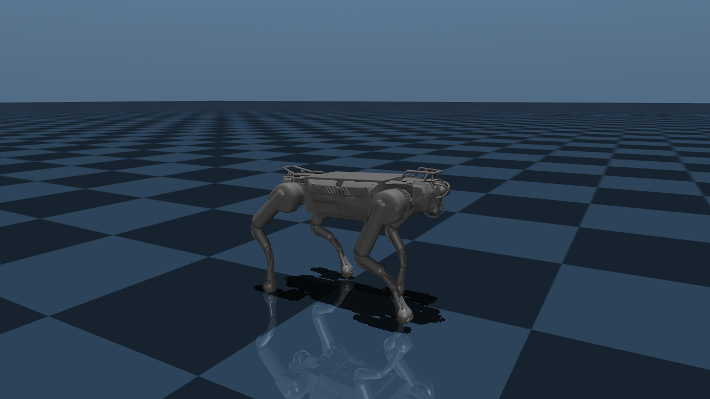
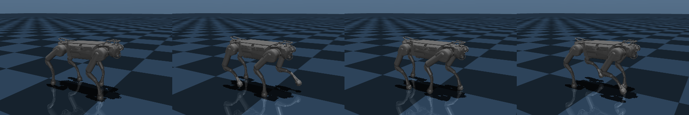

# X30 sim: MotionSDK + on-robot policies in MuJoCo



<p align="center"></p>
<p align="center"><sub>DEEP Robotics' on-robot <code>trot_policy_reflect</code> trotting at 1 m/s in MuJoCo, one stride.</sub></p>

Test the DEEP Robotics X30 MotionSDK and the policies copied off the robot against a simulated X30,
before going near hardware. Everything needed is in this directory:

```
x30_sim/
├── third_party/x30_motion_sdk/   DR MotionSDK V2.0, unmodified, MIT (pybind11 submodule not vendored)
├── policies/*.pt                 DR's TorchScript policies, copied off the robot (not in git; see policies/README.md)
├── assets/X30_mjcf/              DR's X30 MJCF + meshes, unmodified, BSD-3 (from DeepRoboticsLab/deep_robotics_model)
├── x30_model.py  x30_policy.py  calibrate.py  sim_bridge.py  run_policy_sdk.py  run_sim.sh
├── docs/                         README images (docs/render_images.py)
├── sdk/CMakeLists.txt            out-of-tree SDK build → sdk/build/, lib/ (gitignored)
├── .venv/                        uv venv (gitignored)
└── videos/                       recordings (gitignored)
```

```
run_policy_sdk.py ──(SDK pybind, UDP)──► sim_bridge.py ──► MuJoCo X30
  policy @50/100 Hz     0x0111 joint cmds :43893        tau = kp(q*-q) + kd(dq*-dq) + tau_ff
  cmd stream @1 kHz  ◄── 0x0906 RobotDataSDK :43897 ──  1 kHz, real time
```

`sim_bridge.py` speaks the SDK's wire protocol, so any SDK program works against it by using
`127.0.0.1` instead of `192.168.1.103`.

| File | What it is |
| --- | --- |
| `x30_model.py` | Loads `assets/X30_mjcf/X30.xml` and patches it in memory: free joint, motors, IMU, floor at z=0, capsule collisions |
| `sim_bridge.py` | Fake motion host: 0x0114/0x0113 control handover, 0x0111 joint commands, 1 s no-command → damping, state stream |
| `x30_policy.py` | Observation builder + TorchScript runner for DR's policies |
| `calibrate.py` | Offline sweep (no UDP) for the settings the `.pt` files don't record |
| `run_policy_sdk.py` | MotionSDK client: take control → tuck → stand (DR demo poses) → policy, with keyboard commands |
| `sdk/CMakeLists.txt` | Out-of-tree build of the SDK lib and pybind module (→ `lib/`); DR's C++ example only with `-DBUILD_DR_EXAMPLE=ON` |

## Setup

```bash
cd x30_sim
uv venv -p 3.11 .venv
source .venv/bin/activate
uv pip install mujoco==3.15.0 numpy==1.26.4 glfw pybind11 imageio imageio-ffmpeg pynput
uv pip install torch --index-url https://download.pytorch.org/whl/cpu
cmake -S sdk -B sdk/build -Dpybind11_DIR=$(python -m pybind11 --cmakedir) \
      -DPython_EXECUTABLE=$(which python)
cmake --build sdk/build -j
./sdk/build/print_sizes   # EthCommand=12 RobotCmdSDK=240 RobotDataSDK=284
```

## Run

```bash
./run_sim.sh                          # tmux: bridge + viewer | runner, trot_policy_reflect
POLICY=silent_policy ./run_sim.sh     # the other supported policy
HEADLESS=1 ./run_sim.sh               # no viewer
SIM_DISPLAY=:1 ./run_sim.sh           # force an X display
```

`run_sim.sh` activates `.venv` itself and opens a tmux session `x30_sim`: bridge on the left,
runner on the right. `Ctrl-b` + arrow switches panes, `Ctrl-b d` detaches, and
`tmux kill-session -t x30_sim` stops everything. Re-running `run_sim.sh` replaces the old session.

To run by hand, activate the venv in each of two terminals:

```bash
source .venv/bin/activate
python sim_bridge.py [--headless]                          # terminal 1
python run_policy_sdk.py --cmd 1.0 0 0 --duration 10       # terminal 2
```

Keys in the runner terminal (hold to move, release to stop, combine freely, e.g. `w` + `q`):

| Key | Command |
| --- | --- |
| `w` / `s` | forward / back (0.8 m/s) |
| `a` / `d` | left / right (0.4 m/s) |
| `q` / `e` | turn left / right (0.8 rad/s) |
| space | zero all commands |
| `x` | release control (damping) and exit |

Keys are read as X press/release events with `pynput`, the same scheme as IsaacLab's
`Se2Keyboard`: the command is the sum of the held keys. `pynput` hears every window, so keys only
count while the terminal you launched from has focus. `run_sim.sh` notes that window before the
viewer opens. Run by hand, the runner uses whichever window is focused when it starts. Without an
X display (e.g. over ssh) the keyboard is off; use `--cmd` or `--schedule`.

`run_policy_sdk.py` options:

| Option | Default | What it does |
| --- | --- | --- |
| `--policy NAME` | `trot_policy_reflect` | policy file in `policies/` |
| `--cmd VX VY WZ` | `0 0 0` | command once the policy takes over, until a key changes it |
| `--key-speed VX VY WZ` | `0.8 0.4 0.8` | command while a key is held |
| `--any-window` | off | take keys whichever window has focus |
| `--key-window ID` | focused at start | X window that takes keys (`run_sim.sh` sets it) |
| `--duration SECS` | none | exit after this long under the policy |
| `--schedule "secs:vx,vy,wz ..."` | none | timed commands, overriding the keys; exits when it ends |
| `--ip`, `--port`, `--recv-port` | `127.0.0.1`, 43893, 43897 | motion host and state port |
| `--real` | off | allow a non-loopback `--ip` (a real robot) |

**Don't run DR's own examples against the sim.** `example/main.cpp` uses `SendToRobot()`, which
defaults to `192.168.1.103`, and `python/motion_sdk_example.py` hard-codes the same address. Both
talk to a real X30 if one is on your network. That's why `sdk/CMakeLists.txt` only builds the C++
example with `-DBUILD_DR_EXAMPLE=ON`.

Record a video (offscreen GPU rendering, no display needed) with a scripted command schedule:

```bash
source .venv/bin/activate
python sim_bridge.py --headless --record videos/demo.mp4 --duration 37 &
python run_policy_sdk.py --schedule "2:0,0,0 4:1,0,0 4:1,0,0.5 3:1.5,0,0 3:0.7,0,0 4:0,0,0.6 2:0,0,0"
```

## Supported policies

Two of DR's on-robot policies are calibrated and run in the sim: `trot_policy_reflect` (the
default) and `silent_policy`. Both are TorchScript exports from DR's rsl_rl fork (`actor_critic_decoder`,
a DreamWaQ-style CENet estimator). Each takes 6 stacked frames (the current frame, then 5 history
frames) and outputs 12 joint actions. Joint order is FL, FR, HL, HR × HipX, HipY, Knee, the same as
the SDK.

| Policy | Frame | Layout |
| --- | --- | --- |
| `silent_policy` | 45 | ang_vel 3, proj_gravity 3, cmd 3, dof_pos−default 12, dof_vel 12, last_action 12 |
| `trot_policy_reflect` | 52 | ang_vel, gravity, cmd, sin_phase, cos_phase, gait_cmd 5, dof_pos, dof_vel, last_action (names from the export's `reflect_proprioception`) |

`trot_policy_reflect` also takes a `reflect` flag that mirrors left and right; the sim passes 0.

### Calibrated settings (silent_policy, `calibrate.py`)

| Setting | Value | Confidence |
| --- | --- | --- |
| action → target | `default + 0.25·a` | sharp optimum |
| default pose | SDK stand (0, −42°, 78°) | flat; nearby poses score the same |
| dof_vel scale | 0.05 | sharp |
| ang_vel scale / cmd scale | 1.0 / (1, 1, 1) | clear winner |
| policy rate | 100 Hz | clear winner over 50 Hz |
| history order | oldest → newest after the current frame | sharp vs newest-first; can't tell whether it includes the current frame |
| kp / kd | 200 / 4 | flat between 150 and 300 |

Measured in sim, starting from standing:
- **Forward:** tracks 0.6–2.0 m/s.
- **0.2 and 0.5 m/s forward:** it stays standing. 0.4 m/s walks, so this probably isn't a simple deadband.
- **Turning:** tracks ±0.6 rad/s.
- **Backward:** only weakly (−1.0 → −0.4 m/s).
- **Sideways:** about half the commanded speed.

That could be how the silent gait behaves or a gap in the sim dynamics: rotor inertia, motor model
and friction are unknown. Check against robot logs before trusting it.

### trot_policy_reflect (52-dim, preset in `x30_policy.PRESETS`)

This is a separate training run with different settings from `silent_policy`. It uses the classic
legged_gym scales:

| Setting | Value |
| --- | --- |
| cmd scale | × (2, 2, 0.25) |
| ang_vel scale | × 0.25 |
| dof_vel scale | × 0.1 |
| policy rate | 50 Hz |
| history order | oldest → newest |
| gait clock | `sin/cos(2π·φ)`, φ advancing at 2 Hz |
| gait_cmd | (2, 0.5, 0, 0, 0.5) |
| `reflect` input | 0 |

Diagonal feet land together about 95% of the time. Pace, bound or pronk gait_cmd values still
produce a trot, so the policy is trot-only.

Measured in sim:
- **Forward:** 0.5 → 0.55, 1.0 → 1.0 and 1.5 → 1.4 m/s.
- **Backward:** −0.5 → −0.35 m/s.
- **Sideways:** 0.4 → 0.27 m/s.
- **Turning:** 0.8 → 0.62 rad/s.
- **Standing:** creeps forward at about 0.08 m/s.
- **Spin after a run:** survives turning in place right after a 1.5 m/s run, which flips `silent_policy`.

## Not done yet

- **SDK on current firmware:** the API docs for current firmware don't mention this SDK, so it
  hasn't been checked on the robot.
